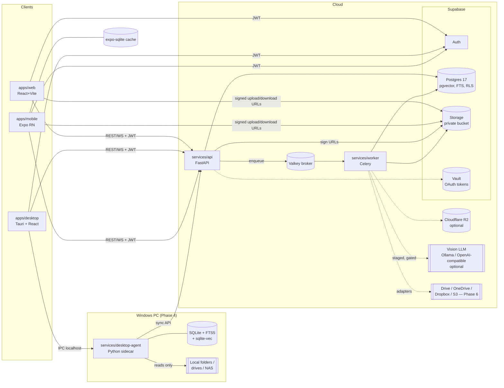
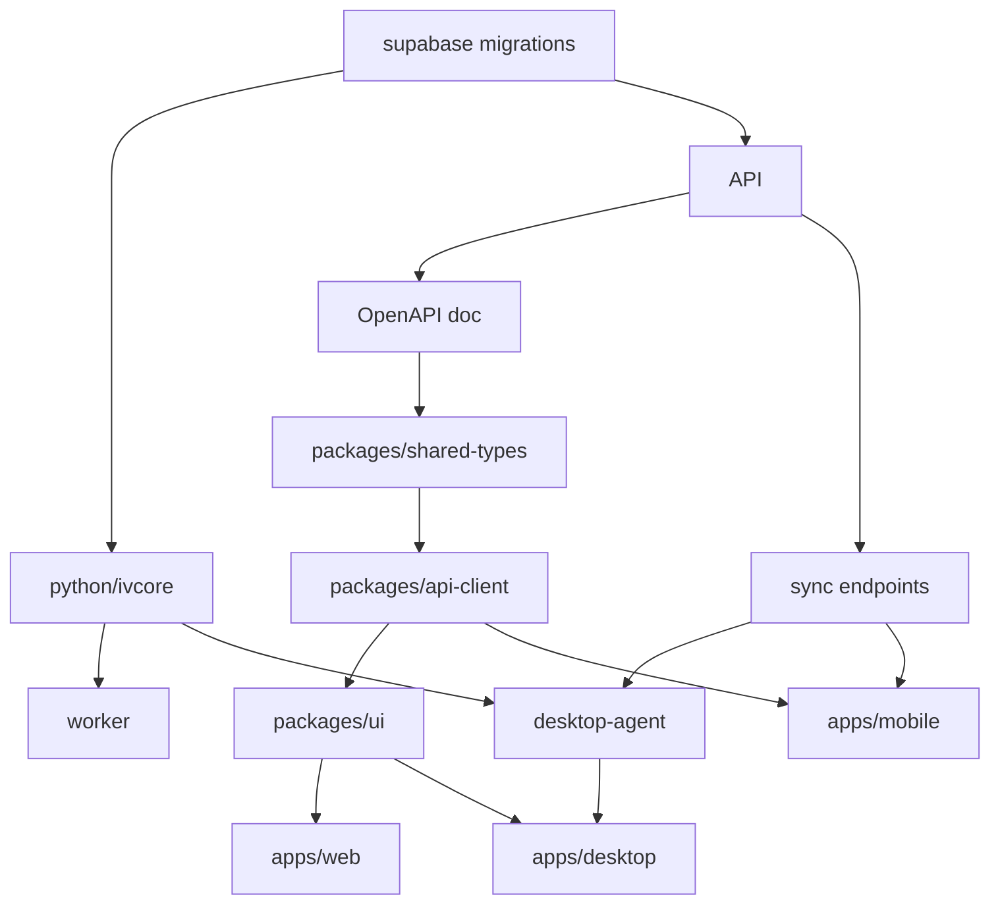

# 02 · System architecture

## 1. Shape of the system
One cloud backend (Supabase Postgres/Auth/Storage + FastAPI + Celery workers), three thin-ish clients, and one local agent on Windows. All clients speak the same versioned REST API; only Auth goes directly to Supabase.

## 2. Component dependency order (build order)

Rule: a component may depend only on things above it. Clients never import server code; the OpenAPI document is the only contract.

## 3. Responsibilities and boundaries
| Component | Owns | Must not |
|---|---|---|
| Postgres | Canonical metadata, RLS tenant isolation, FTS, vectors, job state, change log | Hold binary files |
| Supabase Storage (or R2) | Originals that were uploaded, derivatives (thumbs/previews) | Be publicly readable |
| FastAPI | AuthZ checks beyond RLS, search orchestration, signed URLs, upload sessions, sync, rate limits | Run heavy image work in request path |
| Worker | Pipeline stages, retries, cost accounting | Decide user-facing permissions |
| Desktop agent | Local scan/watch, local processing, local index, push metadata + derivatives | Modify or delete user files |
| Clients | UI, local cache, offline queue | Hold service-role keys or provider secrets |

**Why FastAPI in front of Supabase instead of clients hitting PostgREST directly:** hybrid search, signed-URL issuance, upload sessions, sync batching and rate limiting need server logic; one API surface also keeps desktop/mobile/web identical. The API uses the *user's* JWT for Postgres queries (RLS still applies), and the service role only in workers. Trade-off: one more service to run.

## 4. Key flows
**Upload (Phase 1).** Client → `POST /v1/uploads` (filename, size, sha256) → API checks duplicate by hash; if new, returns a resumable upload target (Supabase Storage TUS endpoint — verify chunk limits in Supabase docs at implementation) → client uploads → `POST /v1/uploads/{id}/complete` → API creates `assets` row (status `pending`) + `processing_jobs` → worker runs identify → metadata → hash/pHash → thumbnail → asset `ready` → WebSocket event to client.

**Search.** `POST /v1/search` with text and/or filters and/or reference asset/region → API builds one SQL query: filter CTE → FTS candidates + vector candidates → reciprocal-rank fusion → returns items with `match_type` (`exact_text`, `keyword`, `semantic`, `visual`) so UI separates exact from AI-suggested hits.

**Reference-only assets (Phase 4/6).** Desktop and connectors index files *in place*; Postgres gets metadata, derivatives go to storage, `original_storage_key` stays null. Opening the original requires the source to be reachable (shown as "available on PC-1 / Google Drive").

## 5. Storage layout
`{workspace_id}/originals/{asset_id}/{sha256}.{ext}` and `{workspace_id}/derived/{asset_id}/{kind}.webp`. Content-addressed names make retries idempotent. Storage adapter interface (`put`, `get_signed_url`, `delete`, `head`) with Supabase Storage and S3/R2 implementations.

## 6. Deployment (proposed)
| Piece | Where | Notes |
|---|---|---|
| Postgres/Auth/Storage | Supabase Pro project | Free tier pauses after 1 week of inactivity — unsuitable beyond dev |
| API + worker + Valkey | One container host (Docker Compose on a VM, or a PaaS) | Host not chosen (D9); price not verified |
| CI | GitHub Actions | DB tests on postgres+pgvector service container |
| Desktop build | GitHub Actions Windows runner, code-signed installer | Signing certificate cost not verified |
| Environments | dev (local Supabase CLI), staging, prod | Separate Supabase projects |

## 7. Cross-cutting
- **Observability:** structured JSON logs (sensitive entity values redacted), request IDs propagated to jobs, Sentry for API/clients (account exists in connectors — confirm use).
- **Config:** env vars only; `.env.example` documents each. No secrets in client bundles.
- **Versioning:** API under `/v1`; pipeline_version on every job so reprocessing is targeted.
- **Backups:** Supabase daily backups (plan-dependent, verify retention); storage bucket replication to R2 [proposed, Phase 3+].
