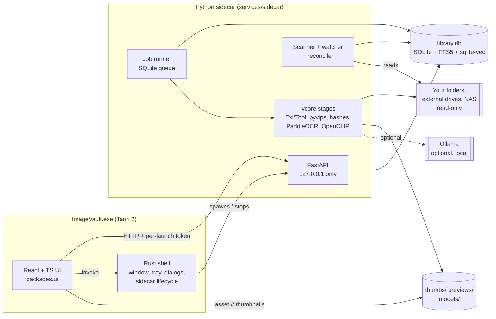
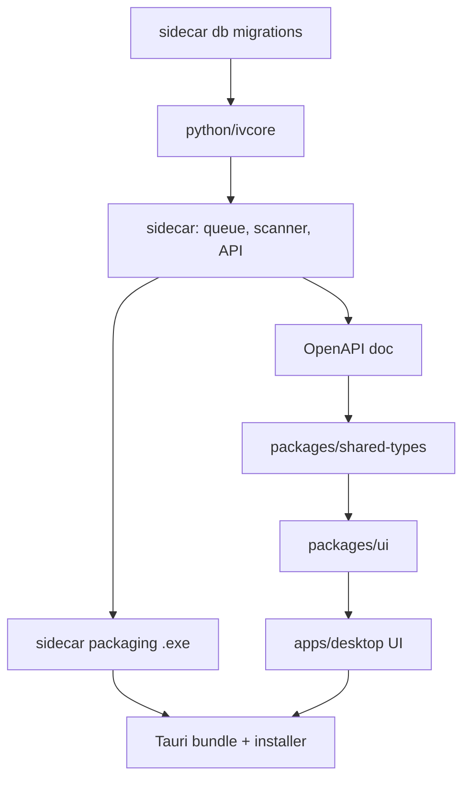

# 02 · System architecture (desktop-only)

## 1. Components


## 2. Dependency / build order


## 3. Why this shape
| Choice | Reason | Trade-off |
|---|---|---|
| Python sidecar, not all-Rust | Spec requires Python for local AI; PaddleOCR, OpenCLIP, ExifTool wrappers, pyvips are Python-first | Must package Python for Windows (PyInstaller or embedded Python — spike in D1) and ship it as a Tauri sidecar |
| UI → sidecar over localhost HTTP (FastAPI) | Same typed contract style as the spec's API; OpenAPI → TS types; easy to test without the UI | Port + token handling; bound to 127.0.0.1, random port, token passed by the shell at launch |
| Sidecar is the **only** DB writer | No SQLite write contention between Rust and Python | Rust shell never touches the DB |
| SQLite + FTS5 + sqlite-vec | One file, no server, free, tested at 100k | sqlite-vec 0.1.x search is brute-force (fine to ~100k–300k, re-evaluate beyond) |
| Persistent queue in SQLite | Survives reboot (spec §16), no Redis | Single machine only — fine for D0 |
| Thumbnails as files, served via Tauri asset protocol | Fast, no base64 over HTTP | Cache folder must be backed up separately or regenerated |

## 4. Process lifecycle
1. App start → shell picks a free port, generates a random token, starts `sidecar.exe --port --token --library <dir>`.
2. Sidecar opens DB (WAL mode), runs pending migrations (`PRAGMA user_version`), requeues `running` jobs left from a crash, starts scanner/watcher and job runner.
3. UI polls `/health` then loads; live updates via a WebSocket (`/events`).
4. Close window → app keeps running in tray if "background indexing" is on; Quit → shell asks sidecar to drain current jobs (≤ 5 s) then stops it.
5. Sidecar crash → shell restarts it (max 3 times / 5 min) and shows a banner.

## 5. Library folder (default `%LOCALAPPDATA%\ImageVault\Library`, movable — Q3)
The per-user installer puts program files in `%LOCALAPPDATA%\ImageVault`; the library is a separate subfolder so program files and data never mix. Verified 2026-11-25 against Tauri's NSIS template: the uninstaller deletes only its own files and a non-recursive `RMDir`, so the library survives uninstall (the optional "delete app data" box only clears `%LOCALAPPDATA%\com.neomags.imagevault`). The shell decides the folder and passes `--library` to the sidecar.
```
library.db (+ -wal, -shm)
thumbs/ab/cd/<asset_uid>_256.webp …   (sharded by uid)
previews/…
models/  (downloaded once, SHA-256 verified)
backups/library-YYYYMMDD.db           (SQLite online backup API, keep last N)
logs/  sidecar.log (rotated 1 MB × 3), startup.log (launch timeline)
```

## 6. Security & privacy (single user, offline)
- Sidecar listens on 127.0.0.1 only; every request needs the per-launch token; CORS locked to the Tauri origin.
- File access is read-only by design: the sidecar opens files with read flags only; no code path deletes/moves user files (enforced by review + a test that runs the full pipeline against a read-only fixture folder).
- No telemetry, no network except model downloads (user-initiated) and optional local Ollama.
- Sensitive entities (phones, emails, addresses) are excluded from logs.
- Optional app lock (Windows Hello) is a later nice-to-have; disk encryption is left to BitLocker.
- Installer is unsigned for personal use (SmartScreen warning on first run); signing only if distributed later.
