# 03 · Database schema and ERD

DDL: [`supabase/migrations/20261125000000_initial_schema.sql`](../supabase/migrations/20261125000000_initial_schema.sql) (draft, 42 tables incl. all 31 required by spec §18 plus gap fixes). Loaded and tested on Postgres 17.12 + pgvector 0.8.7 — see doc 00.

## 1. ERD (core; Phase 7–9 tables abbreviated)

```mermaid
erDiagram
  users ||--o{ memberships : has
  organizations ||--o{ workspaces : contains
  workspaces ||--o{ memberships : grants
  users ||--o{ devices : owns
  workspaces ||--o{ storage_connections : has
  storage_connections ||--o{ storage_locations : lists
  assets ||--o{ storage_locations : "found at"
  workspaces ||--o{ assets : owns
  assets ||--o{ asset_versions : revisions
  assets ||--o{ asset_derivatives : thumbs
  assets ||--|| asset_metadata : exif
  assets ||--o{ asset_regions : regions
  assets ||--o{ asset_embeddings : vectors
  embedding_models ||--o{ asset_embeddings : "produced by"
  asset_regions ||--o{ asset_embeddings : "region vector"
  assets ||--o{ asset_descriptions : describes
  assets ||--o{ extracted_text : ocr
  extracted_text ||--o{ text_regions : boxes
  text_regions ||--o{ extracted_entities : "source of"
  assets ||--o{ extracted_entities : has
  assets ||--o{ asset_tags : tagged
  tags ||--o{ asset_tags : ""
  assets ||--o{ asset_categories : classified
  categories ||--o{ asset_categories : ""
  categories ||--o{ categories : parent
  assets ||--o| knowledge_cards : card
  knowledge_cards ||--o{ knowledge_card_entities : cites
  extracted_entities ||--o{ knowledge_card_entities : ""
  collections ||--o{ collection_assets : holds
  assets ||--o{ collection_assets : ""
  collections ||--o{ collections : nested
  collections ||--o{ collection_shares : shared
  assets ||--o{ asset_notes : notes
  assets ||--o{ asset_faces : faces
  asset_regions ||--|| asset_faces : box
  face_clusters ||--o{ asset_faces : groups
  people ||--o{ asset_faces : "confirmed as"
  people ||--o{ face_clusters : ""
  duplicate_groups ||--o{ duplicate_group_members : members
  assets ||--o{ duplicate_group_members : ""
  assets ||--o{ processing_jobs : jobs
  storage_connections ||--o{ sync_jobs : runs
  workspaces ||--o{ change_log : feed
  workspaces ||--o{ audit_logs : audit
```

Not drawn: `user_preferences`, `consents`, `saved_searches`, `concepts`, `knowledge_relationships` (polymorphic edges).

## 2. Design decisions
| Decision | Why | Trade-off |
|---|---|---|
| `users` is a profile table keyed to `auth.users.id`; trigger creates personal org + workspace + owner membership on sign-up | Spec requires `users`; Supabase owns credentials | Trigger runs as `security definer` — kept minimal |
| Every tenant table carries `workspace_id` (denormalized on child tables) | RLS policies stay one cheap `is_member(workspace_id)` check; no joins in policies | Must be kept consistent by API/worker (FKs to parent do not enforce same workspace) — add check triggers if drift is found in tests |
| `assets` = unique content per workspace (`unique (workspace_id, sha256)`); `storage_locations` = every place it was found | Spec: prevent duplicate indexing, keep all source paths/ids, detect moves/renames/deletions | A "copy" in two folders is one asset with two locations — UI must show this |
| `asset_versions` for content changes at the same location | Edited files keep lineage | Policy: if a location's hash changes → new version on same asset unless new hash already exists as another asset |
| Provenance enum `source/ai/user` + `rejected` flag on tags/categories | Spec §5: don't overwrite user-confirmed data | Workers must upsert with `where origin <> 'user' and not rejected` |
| `asset_metadata.raw_exif` JSONB, typed columns for filterable fields | Spec allows JSONB for extensible metadata | Two copies of a few fields |
| `asset_embeddings.embedding` untyped `vector`, partial HNSW index per model with `::vector(dims)` cast | Swap/upgrade CLIP models without a migration per model; re-embed side by side then flip `is_active` | Queries must include `model_id = X` and the same cast to hit the index (verified with EXPLAIN) |
| pHash stored as `bit(64)` with pgvector `bit_hamming_ops` HNSW | Near-duplicate lookup without a BK-tree service | HNSW is approximate; exact verification step in worker |
| `extracted_text` has generated `tsvector` (simple config) + trigram index | FTS for words, trigram for exact substrings like error codes/phones | `simple` config = no stemming; multilingual stemming deferred |
| `knowledge_relationships` polymorphic | Graph edges between 5 node types without 25 join tables | No FK integrity → API validates; nightly orphan check job |
| `processing_jobs` in Postgres is source of truth; broker only transports | Survives broker loss; queryable queue UI; idempotency key unique | Two systems to keep consistent (reconciler re-enqueues stale `queued`) |
| `change_log` sequence for device pull-sync | Simple, ordered, resumable cursor | Grows forever → prune entries older than the oldest active device cursor + 90 days |
| Soft delete (`deleted_at`) on assets only | Reversible hide; originals untouched | Unique sha256 index is partial on `deleted_at is null` |

## 3. RLS model
- `private.is_member(ws)` / `private.can_write(ws)` (`security definer`, empty `search_path`).
- Read: any member. Write: owner/admin/editor. Viewer is read-only.
- Service-role-only writes: `processing_jobs`, `sync_jobs`, `change_log`, `asset_embeddings`, `audit_logs`.
- Owner-only rows: `devices`, `saved_searches`, `user_preferences`.
- `audit_logs`: readable by owner/admin, no UPDATE/DELETE grants.
- Share links (Phase 3+) are resolved by the API with the service role after token hash check — never by an anon RLS policy.

## 4. Indexes (query → index)
| Query | Index |
|---|---|
| Gallery by import/taken date (keyset) | `assets (workspace_id, imported_at desc, id)`, `(workspace_id, taken_at desc, id)` partial on not deleted |
| Duplicate check on upload | `assets_ws_sha256` unique partial |
| Keyword search | GIN `assets.search_tsv`, `extracted_text.tsv`, `knowledge_cards.tsv` |
| Exact text / phone / error code | GIN trigram on `extracted_text.full_text`; btree on `extracted_entities (workspace_id, entity_type, normalized_value)` |
| Similar images | HNSW cosine per model on `asset_embeddings` |
| Near duplicates | HNSW Hamming on `assets.phash` |
| Job pickup | `processing_jobs (priority, run_after, id) where status='queued'` |
| Sync pull | `change_log (workspace_id, seq)` |

Note on HNSW + RLS: vector index scans apply the workspace filter *after* the ANN search, so a small workspace in a large shared table can get fewer than `k` results. Mitigations: pgvector 0.8 iterative index scans (`hnsw.iterative_scan`), and at scale, partitioning `asset_embeddings` by workspace. To be measured in Phase 3 perf tests.

## 5. Phase 9 additions (not in migration yet)
`plans`, `subscriptions (organization_id, plan_id, status, provider_customer_id, current_period_end)`, `entitlements`, `usage_counters`, `invitations`. Designed when billing provider is chosen.

## 6. Migration policy
Timestamped files under `supabase/migrations`, forward-only; every migration runs in CI against an empty DB and against a snapshot of the previous schema with seed data; destructive changes (drop/rename column) use expand → backfill → contract over two releases.
