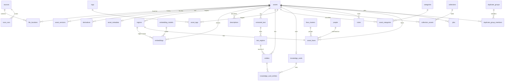

# 03 · Local database schema and ERD

DDL: [`services/sidecar/db/migrations/0001_initial.sql`](../services/sidecar/db/migrations/0001_initial.sql) — 34 tables + 4 virtual tables (2 FTS5, 2 sqlite-vec). Single user, so no organizations/workspaces/memberships/RLS; everything else from spec §18 has a local equivalent.

## 1. Spec table → local table
| Spec (§18) | Local | Note |
|---|---|---|
| users, organizations, workspaces, memberships | — | Single user (D0). Parked in `archive/cloud-supabase` |
| storage_connections / storage_locations | `sources` / `file_locations` | location keyed by NTFS file id → survives renames |
| sync_jobs | `scan_runs` | resumable scans |
| assets, asset_versions, asset_metadata | same names | asset = unique content (sha256) |
| asset_embeddings | `embeddings` + `vec_clip_b32` (sqlite-vec) | one vec0 table per model |
| asset_descriptions, extracted_text, extracted_entities | `descriptions`, `extracted_text` (+ `text_regions`), `entities` | facts link to OCR boxes |
| categories, tags, asset_tags, asset_categories | same | `rejected` flag keeps AI from re-adding |
| people, face_clusters, asset_faces | same | identity requires `confirmed_at` (CHECK) |
| collections, collection_assets | same | smart collections store a JSON rule |
| knowledge_cards, knowledge_relationships | `knowledge_cards`, `knowledge_card_entities`, `concepts`, `relationships` | |
| duplicate_groups | + `duplicate_group_members` | decision is keep/hide; `delete` impossible by CHECK |
| processing_jobs | `jobs` | `UNIQUE (asset_id, stage, pipeline_version)` = idempotency |
| user_preferences, saved_searches, audit_logs | `settings`, `saved_searches`, `audit_log` | audit log append-only via triggers |
| (gap fixes) | `notes`, `regions`, `derivatives`, `embedding_models` | |

## 2. ERD

Not drawn: `settings`, `saved_searches`, `concepts`, `relationships` (polymorphic graph edges), `audit_log`, FTS/vec virtual tables.

## 3. Key design points
- **IDs:** `INTEGER PRIMARY KEY` for speed; `uid` (UUIDv7 text) on assets/sources/collections as a stable id for export or a future sync.
- **Vectors:** sqlite-vec `vec0` tables; rowid = `embeddings.id`. Model swap = new vec0 table + new `embedding_models` row, re-embed, flip `is_active`.
- **pHash:** `vec0(phash bit[64])`, Hamming KNN — near-duplicate lookup with no extra service.
- **Search:** `asset_fts` (unicode61, diacritics removed) for words; `ocr_trigram` (trigram tokenizer) for exact substrings like partial phone numbers or error codes.
- **Cleanup:** triggers delete vec/FTS rows when an asset is deleted (virtual tables don't support foreign keys).
- **Migrations:** numbered SQL files, applied in order, tracked with `PRAGMA user_version`; DB backed up automatically before each migration.

## 4. Test results (executed 2026-11-25, build container: 4 vCPU, no GPU — not Neo's PC)
`python -I services/sidecar/db/tests/test_schema.py 100000` with SQLite 3.53.1, sqlite-vec 0.1.9: **13/13 checks passed** — duplicate sha256 rejected; duplicate file location rejected; face identity without confirmation rejected; out-of-range region rejected; audit log update/delete blocked; duplicate "delete" decision rejected; FTS word match; trigram partial-phone match; vector/pHash rows removed with asset; CLIP KNN correct; pHash exact match found.

| Measurement @100k assets | Result |
|---|---|
| Insert 100k assets + locations + 512-d vectors + pHashes | 7.3 s |
| CLIP 512-d KNN, k=20 (brute force) | 90 ms median, 108 ms max |
| pHash Hamming KNN, k=10 | 2 ms median |
| Gallery first page (60, keyset index) | 1.0 ms |
Random vectors were used; real CLIP vectors don't change brute-force cost.
